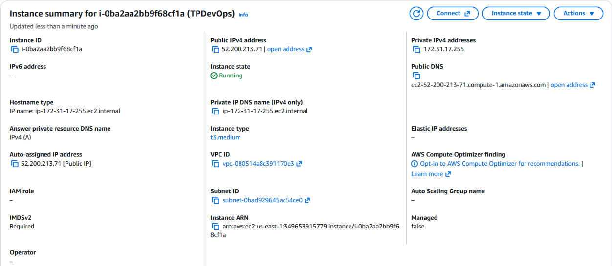
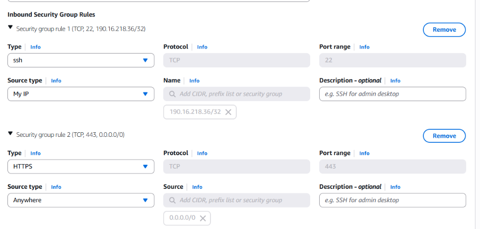
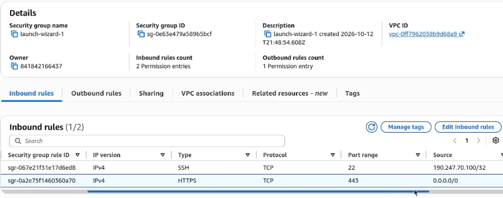
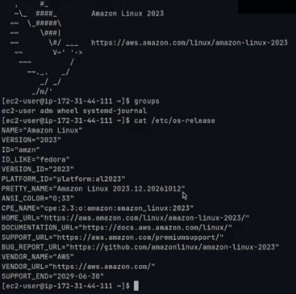

# Configuración de AWS EC2

## 1. Datos de la Instancia, Sistema Operativo y Red (VPC / Subred)

Los siguientes datos corresponden a la sesión del Sandbox de AWS Academy Learner Lab en la que se desplegó y probó el stack completo:

| Parámetro | Valor |
| :--- | :--- |
| **Nombre de la instancia** | `TPDevOps` |
| **Instance ID** | `i-02bd7698d64ea9ea1` |
| **Tipo de instancia** | `t3.medium` (2 vCPU, 4 GiB RAM) |
| **Sistema Operativo / AMI** | Amazon Linux 2023 (`Amazon Linux 2023.12.20261012`) |
| **Nombre de la AMI** | `al2023-ami-2023.12.20261012.0-kernel-6.10-x86_64` |
| **AMI ID** | `ami-09706586205a51eb2` |
| **Arquitectura** | `x86_64` (64-bit) |
| **Almacenamiento (EBS)** | `8 GiB` (`gp3`, 3000 IOPS) |
| **IP Pública (IPv4)** | `32.194.87.233` |
| **DNS Público (IPv4)** | `ec2-32-194-87-233.compute-1.amazonaws.com` |
| **IP Privada (IPv4)** | `172.31.44.111` |
| **Región / Zona de Disponibilidad** | `us-east-1` (N. Virginia) / `us-east-1d` |
| **VPC ID** | `vpc-0ff796200b0fd80a9` |
| **Subnet ID** | `subnet-0df550d950e15a232` (Auto-assign public IP: `Enable`) |



---

## 2. Security Group (Reglas de Entrada y de Salida)

La instancia utiliza el Security Group **`launch-wizard-1`** (`sg-0e63e479a589b5bcf`) asociado a la VPC `vpc-0ff796200b0fd80a9`.

### Reglas de Entrada (Inbound Rules)

| Security Group Rule ID | Tipo | Protocolo | Puerto | Origen (Source) | Descripción |
| :--- | :--- | :--- | :--- | :--- | :--- |
| `sgr-067e21f51e1766ed8` | SSH | TCP | `22` | `190.247.70.100/32` | Acceso SSH restringido exclusivamente a la IP del equipo (`My IP`). |
| `sgr-0a2e75f1460360a70` | HTTPS | TCP | `443` | `0.0.0.0/0` | Acceso público HTTPS hacia el proxy inverso Nginx (`web`). |

- **Puertos cerrados:** El puerto `80` (HTTP) no se encuentra abierto ni publicado. Los puertos internos `3306` (MariaDB), `8080` (APIs) y `8081` (`web2`) tampoco están expuestos en el Security Group y solo son alcanzables dentro de la red interna `app_net` de Docker.

### Reglas de Salida (Outbound Rules)

| Tipo | Protocolo | Puerto | Destino (Destination) | Descripción |
| :--- | :--- | :--- | :--- | :--- |
| All traffic | All | All | `0.0.0.0/0` | Permite descargar paquetes del sistema e imágenes de Docker Hub y consultar por HTTPS las APIs externas de tipo de cambio y geolocalización. |





---

## 3. Conexión a la Instancia EC2

La conexión se realizó por **SSH** utilizando el usuario por defecto de Amazon Linux 2023 (`ec2-user`) y el par de claves RSA `keydevops` (`~/.ssh/keydevops.pem`) generado al lanzar la instancia, asignándole previamente permisos `600` a la clave privada:

```bash
chmod 600 ~/.ssh/keydevops.pem
ssh -i ~/.ssh/keydevops.pem ec2-user@32.194.87.233
```



---

## 4. Configuración Previa en la Instancia Antes de Levantar los Contenedores

Antes de iniciar los contenedores con Docker Compose, la preparación de la instancia se ejecutó mediante los scripts automatizados del proyecto en dos etapas:

### 4.1. Preparación de directorios y archivos de configuración (`transferir.sh` / `transferir.ps1`)
Desde la computadora local se ejecutó `./transferir.sh 32.194.87.233`, el cual configuró en `/home/ec2-user`:
1. Creación de los directorios `db/`, `api-clientes/`, `api-pagos/`, `api-facturas/`, `api-transacciones/`, `api-tarjetas/`, `web2/` y `certs/`.
2. Copia por `scp` de `deploy.sh`, `docker-compose.yml`, los seis archivos `.env` de credenciales y `web2/config.yaml`.
3. Registro de la IP pública en `.deploy-public-ip` y aplicación de permisos `600` sobre los archivos `.env` y `644` sobre `web2/config.yaml`.

### 4.2. Instalación de paquetes y certificado en la EC2 (`deploy.sh`)
Dentro de la instancia se ejecutó `bash ./deploy.sh`, que configuró automáticamente:
1. **Dependencias base:** Comprobación de `curl` (provisto por `curl-minimal` en Amazon Linux 2023) e instalación de `openssl` si no estuviera presente.
2. **Motor de Docker:** Instalación del paquete `docker` (`docker-25.0.16`) mediante `sudo dnf install -y docker` y activación del servicio con `sudo systemctl enable --now docker`.
3. **Plugin de Docker Compose:** Descarga del binario oficial `v5.6.0` para arquitectura `x86_64` e instalación con permisos de ejecución en `/usr/local/lib/docker/cli-plugins/docker-compose`.
4. **Certificado TLS autofirmado:** Generación con `openssl req -x509` del certificado `certs/cert.pem` y la clave privada `certs/key.pem` (permisos `600`) con `CN=32.194.87.233` y `subjectAltName=IP:32.194.87.233,DNS:localhost,IP:127.0.0.1`.
5. **Descarga de imágenes sin `docker login`:** Como las ocho imágenes publicadas en Docker Hub (`yisvs9/fintech-nova-*`) son públicas, no fue necesario ejecutar `docker login` ni almacenar credenciales de Docker Hub en la instancia EC2; `deploy.sh` ejecutó directamente `sudo docker compose pull` y `sudo docker compose up -d`.
