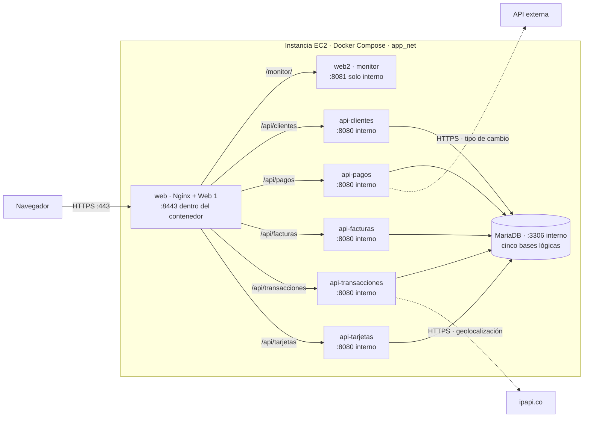
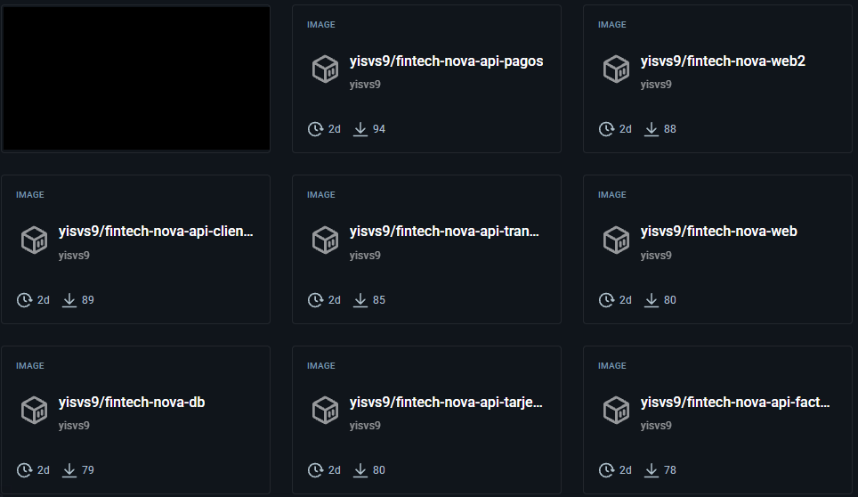
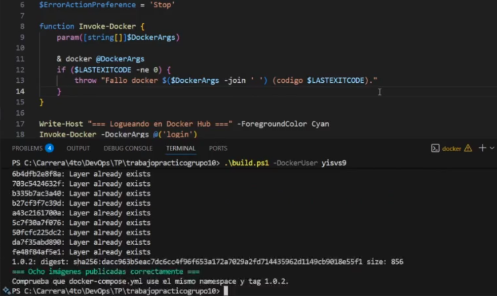
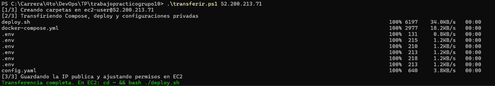
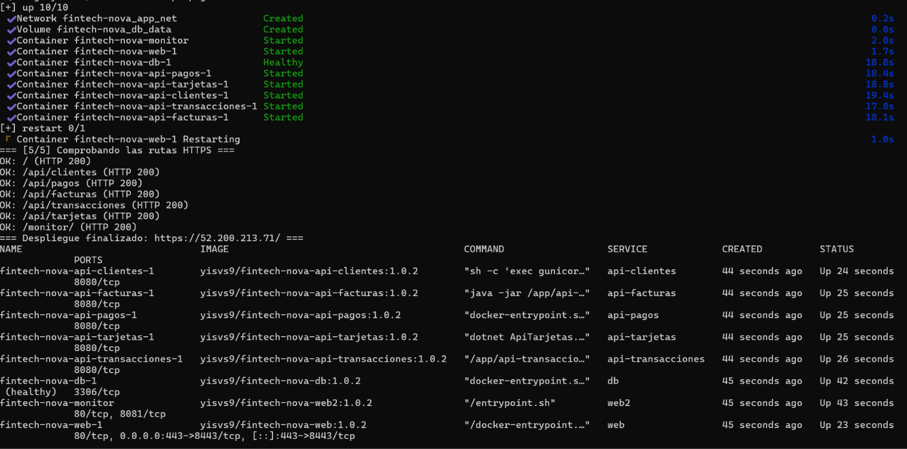
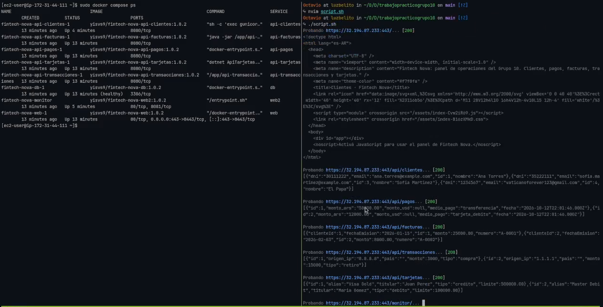
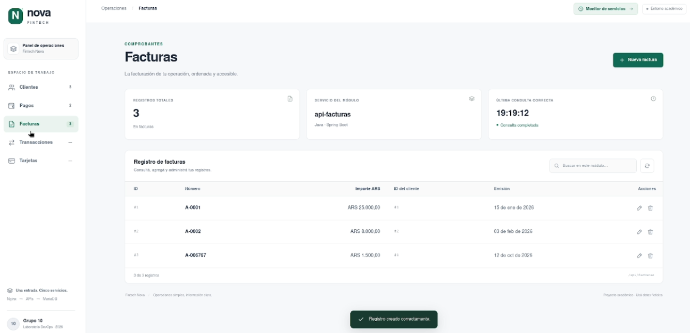
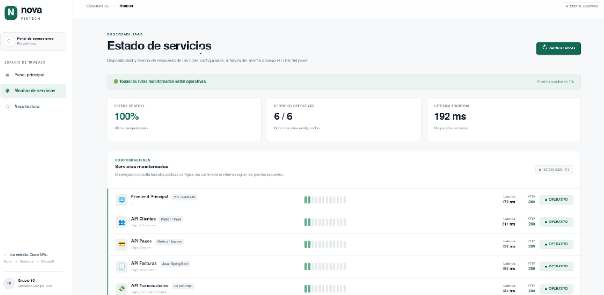

# FinTech Nova - Trabajo Práctico Grupo 10

**Asignatura:** Desarrollo y Operaciones (DevOps) — Ciclo Lectivo 2026  
**Universidad Tecnológica Nacional — Facultad Regional Córdoba (UTN FRC)**

## Integrantes del Grupo

La autoría del trabajo se encuentra visible en el pie de página de la interfaz desplegada (tanto en el panel de operaciones principal como en el monitor de servicios):

- **Arnedo, Jesús**
- **Mendez, Octavio**
- **Paez, Areli**
- **Quiroga, Lucía**
- **Reinoso, Daniel**

---

## Introducción y Decisiones de Diseño

Este proyecto implementa la containerización, orquestación y despliegue automatizado en AWS EC2 de la plataforma **FinTech Nova**. Al tratarse de un grupo de 5 integrantes, el stack incorpora 8 contenedores en total: 5 APIs de negocio, 1 instancia compartida de base de datos y 2 aplicaciones frontend.

Las principales decisiones de diseño adoptadas por el equipo fueron:

1. **Única puerta de entrada HTTPS (Terminación TLS en Nginx):**
   Solo el contenedor `web` publica el puerto `443` en el host (redirigido al `8443` interno). El servidor Nginx termina el tráfico TLS y actúa como proxy inverso hacia las cinco APIs (`/api/*`) y hacia el segundo frontend (`/monitor/` y `/web2/`) mediante HTTP interno sobre la red privada `app_net`. El puerto `80` permanece cerrado tanto en Docker Compose como en el Security Group de AWS.
2. **Generación de certificados TLS en Runtime (EC2):**
   Se decidió no generar el certificado autofirmado durante el `docker build` para evitar que la clave privada (`key.pem`) quedara embebida en las capas de una imagen pública en Docker Hub. En su lugar, `deploy.sh` genera el par de claves directamente dentro de la instancia EC2 utilizando su IP pública vigente en el campo `SAN` (*Subject Alternative Name*) y lo monta en `web` como volumen de solo lectura (`:ro`).
3. **Dockerización optimizada y usuarios No-Root:**
   Se aplicaron construcciones *multistage* en los microservicios compilados (`api-facturas` con Maven/JRE, `api-transacciones` con Go/Alpine, `api-tarjetas` con .NET SDK/ASP.NET Runtime y `web` con Node/Nginx) para reducir la superficie de ataque y el tamaño de las imágenes finales. Las APIs se ejecutan con usuarios del sistema sin privilegios (`app` / `node`).
4. **Instancia única de MariaDB con 5 esquemas lógicos:**
   Un único contenedor basado en `mariadb:11.8.9-ubi9` aloja las cinco bases de datos (`db_clientes`, `db_pagos`, `db_facturas`, `db_transacciones` y `db_tarjetas`). Los scripts en `/docker-entrypoint-initdb.d/` inicializan los esquemas automáticamente y los datos persisten en el volumen `db_data`. Se configuró un `healthcheck` de conectividad para que las APIs aguarden a que la base esté lista (`service_healthy`) antes de iniciar.
5. **Gestión de secretos fuera del repositorio:**
   Ninguna contraseña ni clave privada se almacena en Git ni en las imágenes. Las variables sensibles se transfieren mediante `scp` con permisos restringidos (`600`) y se inyectan con `env_file` utilizando `format: raw` para evitar que Docker Compose interpole caracteres especiales como `$`.
6. **Límites de recursos y resiliencia:**
   Todos los contenedores definen `restart: always` y límites explícitos de CPU y memoria (`deploy.resources.limits`) dimensionados para ejecutarse simultáneamente en una instancia `t3.medium`, ajustando además el heap de la JVM en `api-facturas` (`-XX:MaxRAMPercentage=60.0`). Las llamadas a APIs externas (`api-pagos` y `api-transacciones`) toleran fallos o límites de tasa (*Rate Limit*) guardando la entidad aún sin el dato enriquecido.
7. **Segundo Frontend (`web2` - Monitor de Servicios):**
   Se desarrolló un panel de monitoreo accesible bajo `/monitor/` que verifica periódicamente el estado y la latencia de los endpoints públicos, representa gráficamente el flujo de red interno y envía alertas automáticas a un grupo de Telegram ante la caída o recuperación de cualquier microservicio.

---

## Arquitectura



El Security Group permite HTTPS `443` desde Internet y limita SSH `22` a la IP autorizada.
Solo `web` publica un puerto del host (`443:8443`); las cinco APIs, MariaDB y `web2`
se comunican por la red privada `app_net`. El navegador ejecuta el JavaScript de ambas
webs y consulta `/api/*` a través del mismo Nginx: `web2` no llama directamente a las APIs.
El certificado y la clave se generan en EC2 y se montan en `web` como solo lectura;
los datos de MariaDB persisten en el volumen `db_data`. Las ocho imágenes se descargan
de Docker Hub antes de levantar el stack.

---

## Imágenes en Docker Hub

El archivo `docker-compose.yml` consume directamente las ocho imágenes públicas alojadas en Docker Hub (sin utilizar `build:` en la instancia EC2):

| Servicio | Stack / Tecnología | Imagen en Docker Hub | Link al Repositorio |
| :--- | :--- | :--- | :--- |
| `db` | MariaDB 11.8.9 (UBI9) | `yisvs9/fintech-nova-db` | [Ver en Docker Hub](https://hub.docker.com/r/yisvs9/fintech-nova-db) |
| `api-clientes` | Python 3.12 (Flask + Gunicorn) | `yisvs9/fintech-nova-api-clientes` | [Ver en Docker Hub](https://hub.docker.com/r/yisvs9/fintech-nova-api-clientes) |
| `api-pagos` | Node.js 24 (Express) | `yisvs9/fintech-nova-api-pagos` | [Ver en Docker Hub](https://hub.docker.com/r/yisvs9/fintech-nova-api-pagos) |
| `api-facturas` | Java 21 (Spring Boot) | `yisvs9/fintech-nova-api-facturas` | [Ver en Docker Hub](https://hub.docker.com/r/yisvs9/fintech-nova-api-facturas) |
| `api-transacciones` | Go 1.26 (`net/http`) | `yisvs9/fintech-nova-api-transacciones` | [Ver en Docker Hub](https://hub.docker.com/r/yisvs9/fintech-nova-api-transacciones) |
| `api-tarjetas` | .NET 8 (ASP.NET Core Minimal API) | `yisvs9/fintech-nova-api-tarjetas` | [Ver en Docker Hub](https://hub.docker.com/r/yisvs9/fintech-nova-api-tarjetas) |
| `web` | Vite + Nginx 1.30 (Proxy HTTPS) | `yisvs9/fintech-nova-web` | [Ver en Docker Hub](https://hub.docker.com/r/yisvs9/fintech-nova-web) |
| `web2` | Nginx Alpine + `yq` (Monitor) | `yisvs9/fintech-nova-web2` | [Ver en Docker Hub](https://hub.docker.com/r/yisvs9/fintech-nova-web2) |





---

## Construir y publicar las imágenes (computadora local)

Desde la raíz del proyecto, con Docker disponible y una sesión iniciada en Docker Hub:

```bash
./deploy.sh --build yisvs9
```

Esta opción construye y publica las ocho imágenes (`db`, cinco APIs, `web` y `web2`).
Las siete primeras usan la raíz como contexto de build; `web2` usa su propia carpeta.
No se ejecuta en la EC2. En Windows, el script Bash requiere WSL con la integración
de Docker Desktop activada; también se pueden ejecutar sus comandos `docker build`
y `docker push` desde PowerShell. Los `.env` y certificados quedan fuera del contexto
gracias a `.dockerignore` y no se publican dentro de las imágenes.

---

## Despliegue en AWS EC2

El flujo de despliegue tiene **dos pasos**. Ambos scripts de transferencia aceptan la IP pública
de la instancia como único argumento; el usuario SSH es `ec2-user` y la llave debe estar en
`~/.ssh/keydevops.pem` (Windows: `$HOME\.ssh\keydevops.pem`). Se ejecutan desde la raíz del
proyecto y requieren los seis `.env` y `web2/config.yaml` completos. Este último puede crearse
a partir de `web2/config.yaml.example`. La llave y esos archivos nunca se suben a Git.

1. **En la computadora local**, transferir la configuración. Elegir **una** de estas opciones:

   Linux/WSL:

   ```bash
   bash ./transferir.sh <IP_PUBLICA_EC2>
   ```

   Windows PowerShell:

   ```powershell
   .\transferir.ps1 <IP_PUBLICA_EC2>
   ```

   El script crea `db/`, las carpetas de las cinco APIs, `web2/` y `certs/` en el home de
   `ec2-user`. Después copia `deploy.sh`, `docker-compose.yml`, los `.env` y
   `web2/config.yaml`, ajusta permisos y guarda la IP pública para el certificado. Si falla
   cualquier transferencia, se detiene. En WSL la llave debe estar en el home **de WSL**
   con permisos `600`; no basta con tenerla en el home de Windows.

2. **Dentro de la EC2**, ejecutar sin argumentos:

   ```bash
   cd ~
   bash ./deploy.sh
   ```

   `deploy.sh` valida los archivos, instala Docker y el plugin Compose si faltan, genera en
   EC2 un certificado autofirmado con la IP pública en el SAN, descarga las ocho imágenes
   públicas, levanta el stack y espera HTTP 200 en las siete rutas HTTPS. En ejecuciones
   posteriores reutiliza lo instalado y el certificado mientras coincida con la IP y siga
   vigente. Si debe renovarlo, conserva copia del par anterior en `certs/`.

El certificado **no** está firmado por una autoridad de confianza: el navegador advertirá
aunque el SAN coincida con la IP. Para probar desde la computadora local se usa
`curl -k https://<IP_PUBLICA_EC2>/`. El Security Group debe permitir solo SSH `22` desde la
IP del equipo y HTTPS `443` desde Internet; no abrir `80`, `3306` ni los `8080` internos.
Los scripts no crean la instancia ni modifican el Security Group. La imagen de la DB ya incluye
los scripts SQL de inicialización, por lo que no se copian por separado a la EC2.





---

## Evidencia de Funcionamiento en AWS EC2

Durante la sesión del Sandbox de AWS Academy (IP pública `32.194.87.233`), se validó el funcionamiento de punta a punta tanto por consola como desde el navegador web:

### 1. Comprobación de Endpoints Públicos con `curl`

Se consultaron las rutas públicas expuestas por el Nginx de `web` a través de HTTPS (`-k` por certificado autofirmado), obteniendo código `HTTP 200` y las respuestas JSON correspondientes de cada microservicio:

```bash
curl -k [https://32.194.87.233/](https://32.194.87.233/)
curl -k [https://32.194.87.233/api/clientes](https://32.194.87.233/api/clientes)
curl -k [https://32.194.87.233/api/pagos](https://32.194.87.233/api/pagos)
curl -k [https://32.194.87.233/api/facturas](https://32.194.87.233/api/facturas)
curl -k [https://32.194.87.233/api/transacciones](https://32.194.87.233/api/transacciones)
curl -k [https://32.194.87.233/api/tarjetas](https://32.194.87.233/api/tarjetas)
curl -k [https://32.194.87.233/monitor/](https://32.194.87.233/monitor/)
```



### 2. Aplicación Principal (`web`) y ABM de las 5 Entidades

Al acceder mediante `https://32.194.87.233/` (confirmando previamente que `http://` no responde al estar el puerto 80 cerrado), se acepta la advertencia del certificado autofirmado y se accede al panel operativo de FinTech Nova, donde se probaron las operaciones de alta, lectura, modificación y baja sobre Clientes, Pagos (con conversión a USD), Facturas, Transacciones (con geolocalización de IP) y Tarjetas.



### 3. Segundo Frontend (`web2` - Monitor) y Alertas por Telegram

En `https://32.194.87.233/monitor/` se verificó el estado operativo y la latencia de los microservicios, la visualización interactiva de la arquitectura interna y el envío de notificaciones en tiempo real al grupo de Telegram (`MonitorGrupo10DevOps`) al simular la caída y posterior recuperación de un contenedor.



---

## Posibles Mejoras Identificadas

1. **Segregación de usuarios de Base de Datos por microservicio:** Actualmente un mismo usuario de aplicación tiene permisos sobre los 5 esquemas lógicos dentro de la instancia de MariaDB. Una mejora de seguridad de mínimo privilegio consiste en crear en `00-databases.sh` cinco usuarios distintos, restringiendo a cada API el acceso exclusivo a su propio esquema.
2. **Automatización de infraestructura con IaC (Terraform / AWS CLI):** Incorporar la creación de la instancia EC2 y las reglas del Security Group mediante código para evitar la configuración manual en la consola web ante cada reinicio de sesión del Sandbox de AWS Academy.
3. **Pipeline de CI/CD en GitLab:** Automatizar la construcción de imágenes, el escaneo de vulnerabilidades (Trivy) y el `push` a Docker Hub ante cada cambio en la rama `main`.
4. **Dominio propio y certificados válidos (Let's Encrypt):** En un entorno productivo con IP elástica y nombre de dominio (DNS), reemplazar el certificado autofirmado por uno emitido automáticamente mediante Certbot / ACME para eliminar la advertencia en los navegadores.
5. **Caché y simulación de APIs externas:** Agregar una capa de caché temporal para la cotización del dólar y las consultas de geolocalización en `ipapi.co`, reduciendo el impacto de los límites de tasa (*Rate Limiting*) de los proveedores gratuitos.

---

## Documentación del Proyecto

- [**AWS_EC2.md**](AWS_EC2.md): Detalle de la instancia EC2, VPC, Subred, reglas del Security Group, acceso SSH y aprovisionamiento.
- [**SEGURIDAD.md**](SEGURIDAD.md): Gestión de secretos, generación de certificados TLS en runtime y buenas prácticas aplicadas en los contenedores.
- [**ERRORES.md**](ERRORES.md): Glosario de los fallos encontrados durante el desarrollo y el despliegue, junto con sus causas y soluciones.
- [**GUIA-INICIO-LOCAL.md**](GUIA-INICIO-LOCAL.md): Instructivo paso a paso para levantar y probar el entorno localmente.