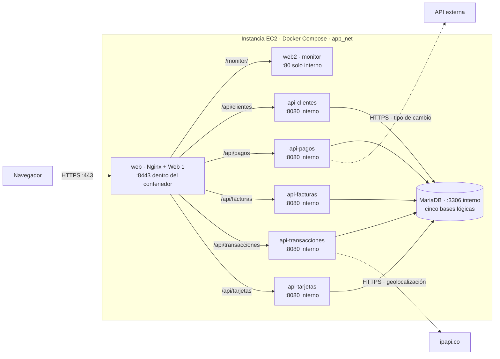

# FinTech Nova - Trabajo Práctico Grupo 10

## Arquitectura



El Security Group permite HTTPS `443` desde Internet y limita SSH `22` a la IP autorizada.
Solo `web` publica un puerto del host (`443:8443`); las cinco APIs, MariaDB y `web2`
se comunican por la red privada `app_net`. El navegador ejecuta el JavaScript de ambas
webs y consulta `/api/*` a través del mismo Nginx: `web2` no llama directamente a las APIs.
El certificado y la clave se generan en EC2 y se montan en `web` como solo lectura;
los datos de MariaDB persisten en el volumen `db_data`. Las ocho imágenes se descargan
de Docker Hub antes de levantar el stack.

## Construir y publicar las imágenes (computadora local)

Desde la raíz del proyecto, con Docker disponible y una sesión iniciada en Docker Hub:

```bash
./deploy.sh --build yisvs9
```

Esta opción construye y publica las ocho imágenes (`db`, cinco APIs, `web` y `web2`).
Las siete primeras usan la raíz como contexto de build; `web2` usa su propia carpeta.
No se ejecuta en la EC2. En Windows, el script Bash requiere WSL con la integración
de Docker Desktop activada; también se pueden ejecutar sus comandos `docker build`
y `docker push` desde PowerShell. Los `.env` y certificados quedan fuera del contexto
gracias a `.dockerignore` y no se publican dentro de las imágenes.

## Despliegue en AWS EC2

El flujo de despliegue tiene **dos pasos**. Ambos scripts de transferencia aceptan la IP pública
de la instancia como único argumento; el usuario SSH es `ec2-user` y la llave debe estar en
`~/.ssh/keydevops.pem` (Windows: `$HOME\.ssh\keydevops.pem`). Se ejecutan desde la raíz del
proyecto y requieren los seis `.env` y `web2/config.yaml` completos. Este último puede crearse
a partir de `web2/config.yaml.example`. La llave y esos archivos nunca se suben a Git.

1. **En la computadora local**, transferir la configuración. Elegir **una** de estas opciones:

   Linux/WSL:

   ```bash
   bash ./transferir.sh <IP_PUBLICA_EC2>
   ```

   Windows PowerShell:

   ```powershell
   .\transferir.ps1 <IP_PUBLICA_EC2>
   ```

   El script crea `db/`, las carpetas de las cinco APIs, `web2/` y `certs/` en el home de
   `ec2-user`. Después copia `deploy.sh`, `docker-compose.yml`, los `.env` y
   `web2/config.yaml`, ajusta permisos y guarda la IP pública para el certificado. Si falla
   cualquier transferencia, se detiene. En WSL la llave debe estar en el home **de WSL**
   con permisos `600`; no basta con tenerla en el home de Windows.

2. **Dentro de la EC2**, ejecutar sin argumentos:

   ```bash
   cd ~
   bash ./deploy.sh
   ```

   `deploy.sh` valida los archivos, instala Docker y el plugin Compose si faltan, genera en
   EC2 un certificado autofirmado con la IP pública en el SAN, descarga las ocho imágenes
   públicas, levanta el stack y espera HTTP 200 en las siete rutas HTTPS. En ejecuciones
   posteriores reutiliza lo instalado y el certificado mientras coincida con la IP y siga
   vigente. Si debe renovarlo, conserva copia del par anterior en `certs/`.

El certificado **no** está firmado por una autoridad de confianza: el navegador advertirá
aunque el SAN coincida con la IP. Para probar desde la computadora local se usa
`curl -k https://<IP_PUBLICA_EC2>/`. El Security Group debe permitir solo SSH `22` desde la
IP del equipo y HTTPS `443` desde Internet; no abrir `80`, `3306` ni los `8080` internos.
Los scripts no crean la instancia ni modifican el Security Group. La imagen de la DB ya incluye
los scripts SQL de inicialización, por lo que no se copian por separado a la EC2.

Los fallos observados durante el desarrollo y sus verificaciones están en [ERRORES.md](ERRORES.md).
