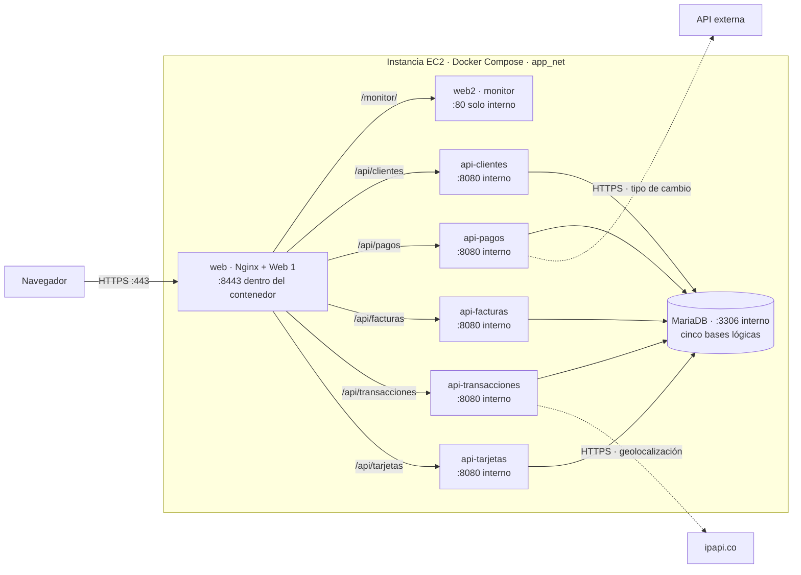

# FinTech Nova - Trabajo Práctico Grupo 10

## Arquitectura



El Security Group permite HTTPS `443` desde Internet y limita SSH `22` a la IP autorizada.
Solo `web` publica un puerto del host (`443:8443`); las cinco APIs, MariaDB y `web2`
se comunican por la red privada `app_net`. El navegador ejecuta el JavaScript de ambas
webs y consulta `/api/*` a través del mismo Nginx: `web2` no llama directamente a las APIs.
El certificado y la clave se generan en EC2 y se montan en `web` como solo lectura;
los datos de MariaDB persisten en el volumen `db_data`. Las ocho imágenes se descargan
de Docker Hub antes de levantar el stack.

## Construir y publicar las imágenes (computadora local)

Desde la raíz del proyecto, con Docker disponible y una sesión iniciada en Docker Hub:

```bash
./deploy.sh --build yisvs9
```

Esta opción construye y publica las ocho imágenes (`db`, cinco APIs, `web` y `web2`).
Las siete primeras usan la raíz como contexto de build; `web2` usa su propia carpeta.
No se ejecuta en la EC2. En Windows, el script Bash requiere WSL con la integración
de Docker Desktop activada; también se pueden ejecutar sus comandos `docker build`
y `docker push` desde PowerShell. Los `.env` y certificados quedan fuera del contexto
gracias a `.dockerignore` y no se publican dentro de las imágenes.

## Despliegue en AWS EC2

Para desplegar la infraestructura en la instancia EC2, utilizamos dos scripts: `transferir.sh` (ejecutado localmente) y `deploy.sh` (ejecutado en el servidor). 

Antes de comenzar, asegúrate de editar las variables `EC2_USER`, `EC2_IP` y `SSH_KEY` dentro del archivo `transferir.sh` con los datos correspondientes a tu sesión de AWS Academy.

Sigue estos pasos en orden:

### 1. Preparar el servidor remoto
**En tu computadora local**, ejecuta el siguiente comando para enviar los archivos `deploy.sh` y `docker-compose.yml` al servidor:
```bash
./transferir.sh --preparar
```

### 2. Configurar dependencias e infraestructura
**Conectado al servidor EC2 por SSH**, ejecuta el script de despliegue para instalar Docker, crear las carpetas necesarias y generar el certificado SSL:
```bash
./deploy.sh --preparar
```

### 3. Transferir configuraciones y secretos
**De vuelta en tu computadora local**, transfiere todos los archivos `.env` y `web2/config.yaml` a las carpetas que acaba de crear el paso anterior en el servidor. Si falta `web2/config.yaml`, crealo a partir de `web2/config.yaml.example` antes de transferir:
```bash
./transferir.sh --levantar
```

### 4. Validar archivos y levantar el stack
**Conectado nuevamente al servidor EC2 por SSH**, ejecuta el último paso para validar los archivos, descargar las imágenes, poner en marcha los contenedores y comprobar las rutas HTTPS:
```bash
./deploy.sh --levantar
```

Los fallos observados durante el desarrollo y sus verificaciones están en [ERRORES.md](ERRORES.md).
